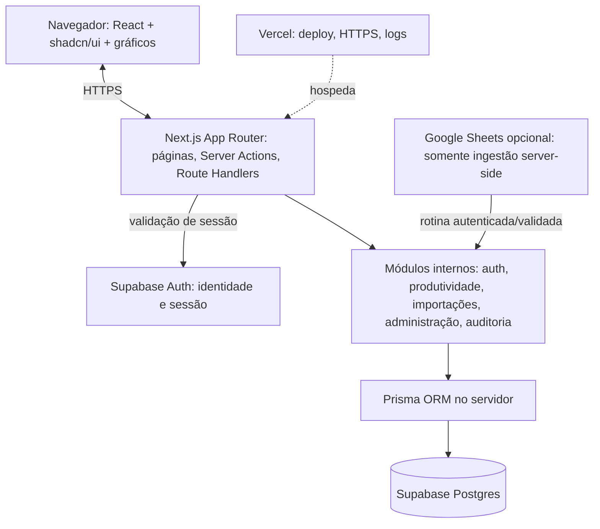

# Arquitetura — monólito modular em Next.js

## Decisão

**Um projeto Next.js App Router = UI + endpoints + regras de negócio + integração com Postgres.** Isolar módulos por domínio, não criar microsserviços nem repositórios independentes.



## Princípios

- `app/`: roteamento, layouts, carregamento e endpoints finos; não conter Prisma queries extensas nem regra da meta.
- `modules/`: limites de negócio. Módulo expõe serviços/casos de uso e tipos; não importar infraestrutura privada de outro módulo.
- `components/ui/`: shadcn/ui; `components/dashboard/`: cards, filtros, gráficos e tabela.
- `lib/`: conexões de infraestrutura compartilhadas (`prisma.ts`, `supabase/client.ts`, `supabase/server.ts`, validadores gerais).
- `prisma/`: schema e migrations; migrações controladas via Prisma CLI.
- Server Components por padrão; Client Components somente para dropdowns, tema, gráficos e interações.
- `proxy.ts` para refresh de cookies da sessão com Supabase SSR (Next 16+); **cada rota/caso de uso ainda valida usuário e autorização**.
- Acesso Postgres exclusivamente do servidor. Não enviar `DATABASE_URL` ao bundle frontend.
- Padrão de erros consistente; paginação/filtragem no servidor, não carregar toda a tabela de produção no browser.

## Estrutura alvo

```text
painel-produtividade/
├── AGENTS.md
├── .env.example
├── app/
│   ├── (auth)/login/page.tsx
│   ├── (auth)/auth/callback/route.ts
│   ├── (protected)/layout.tsx
│   ├── (protected)/dashboard/page.tsx
│   ├── (protected)/admin/importacoes/page.tsx
│   ├── (protected)/admin/usuarios/page.tsx
│   ├── api/v1/dashboard/summary/route.ts
│   ├── api/v1/dashboard/monthly/route.ts
│   ├── api/v1/dashboard/supervisors/route.ts
│   ├── api/v1/productivity/route.ts
│   ├── api/v1/productivity/export/route.ts
│   ├── api/v1/imports/route.ts
│   ├── layout.tsx
│   ├── globals.css
│   └── page.tsx
├── modules/
│   ├── auth/{domain,application,infrastructure}/
│   ├── productivity/{domain,application,infrastructure}/
│   ├── imports/{domain,application,infrastructure}/
│   ├── users/{domain,application,infrastructure}/
│   └── audit/{domain,application,infrastructure}/
├── components/
│   ├── ui/                    # gerado pelo shadcn
│   └── dashboard/             # widgets e gráficos do domínio
├── lib/
│   ├── prisma.ts
│   ├── supabase/{client,server,proxy}.ts
│   ├── security/permissions.ts
│   └── utils.ts
├── prisma/{schema.prisma,migrations/}
├── prisma.config.ts
├── public/brand/logo.png
├── tests/{unit,integration}/
├── e2e/
├── docs/
├── proxy.ts
└── package.json
```

Essa é uma **estrutura-alvo proposta**, não diretórios existentes. Os nomes de endpoints podem mudar se os contratos forem preservados e a alteração registrada em ADR.

## Exemplos de fluxo

**Dashboard:** browser → página protegida → `requireSession()` → `requireRoleAndScope()` → `getDashboardSummary(filters)` → `ProductivityRepository` → Prisma → Postgres → DTO JSON → gráfico React.

**Exportação:** browser envia filtros → endpoint autentica/autoriza → Zod valida → consulta páginas completas com escopo da permissão → geração CSV segura → resposta `text/csv`.

**Importação:** administrador envia XLSX/CSV → parse e pré-visualização → validação Zod + competência/ano → staging/relatório de erros → transação idempotente → importBatch + audit log → invalidar cache/revalidar dashboard.

## Decisões operacionais

- Não misturar `supabase.from('productivity')` no cliente com Prisma para ler as mesmas tabelas. Usar Prisma server-side sob RBAC; Supabase JS client focado em login/logout e sessão.
- Tabelas da aplicação devem ser protegidas: se Data API não for necessária, desabilitar exposição dessas tabelas e/ou configurar RLS e revogar grants conforme política. RLS **não substitui** RBAC de serviços Prisma.
- Clientes Prisma em runtime Node (não Edge), conexão serverless usando pooler correto e tamanho de pool limitado.
- Cálculo de agregados reutilizável: camada de domínio com testes de contrato; server aggregation quando volumes aumentarem.

## Fontes oficiais

- https://nextjs.org/docs/app/getting-started/installation
- https://nextjs.org/docs/app/getting-started/proxy
- https://supabase.com/docs/guides/auth/server-side/creating-a-client
- https://supabase.com/docs/guides/database/prisma
- https://www.prisma.io/docs/guides/v7/frameworks/nextjs
